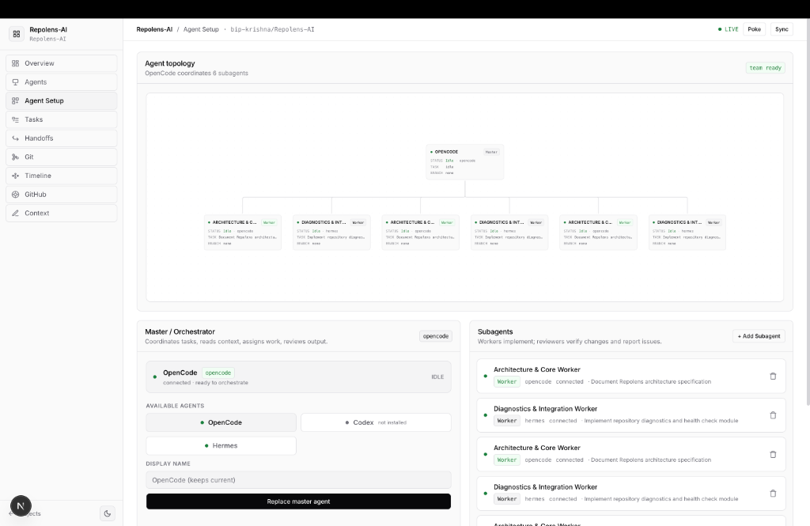
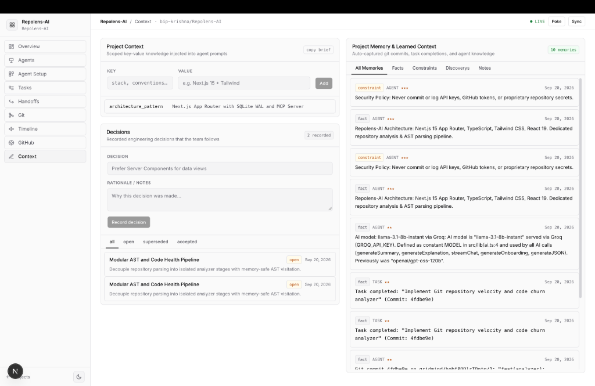
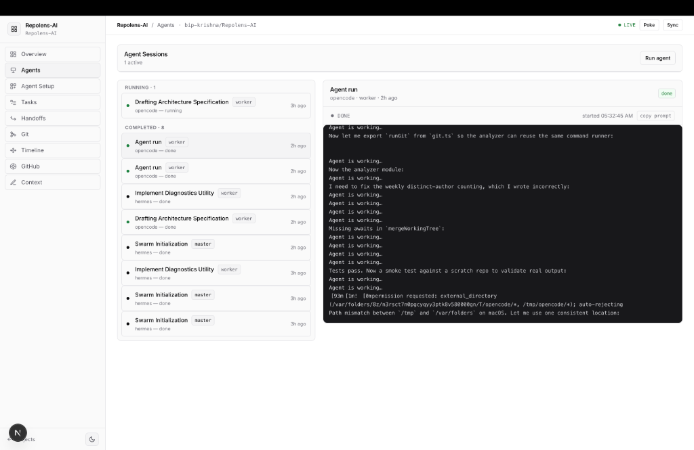
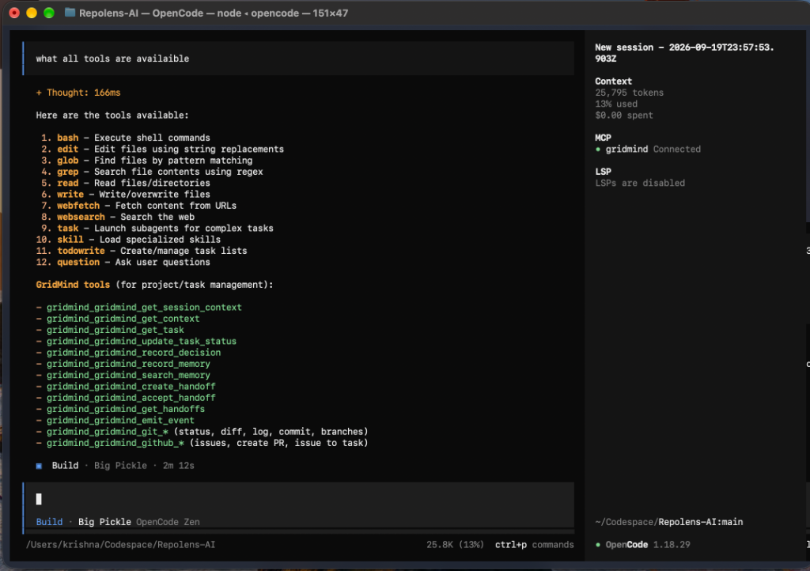

# GridMind 🧠⚡

> **Autonomous AI Agent Control & Coordination Plane for Software Engineering**  
> Unifies **Full-Stack Web Dashboard + Sandboxed Git Worktrees + Model Context Protocol (MCP) + Autonomous Agent Swarms + Structured Handoffs + GitHub PRs** into one cohesive developer workflow.

---

## Simple project memory (CLI and desktop coding clients)

Install once from this checkout (Node 22+, with Node 26 pinned in `.nvmrc`):

```bash
npm install --global /absolute/path/to/Gridmind
```

Then, inside any project, run:

```bash
gridmind init
```

That is the per-project setup. No agent selection, dashboard server, API address, or copied session token is required. The standalone memory server is bundled, so a Next.js/dashboard build is unnecessary. Where npm allows lifecycle scripts, the prepare step refreshes that bundle; otherwise the shipped bundle remains usable. This repository is still a private local package, so a public `npx gridmind` install is **not published or verified**. Keep the source installation in place when using npm's local-directory global link.

`init` configures the supported clients for this folder, even if you install a client later:

| Client | Project configuration |
|---|---|
| ChatGPT desktop local computer sessions / Codex CLI and IDE | `.codex/config.toml` |
| Claude Code | `.mcp.json` |
| Cursor | `.cursor/mcp.json` |
| OpenCode V1 or V2 | Existing `opencode.json`/`.jsonc`, otherwise `opencode.jsonc` |

Codex loads project configuration only for trusted projects. Clients may require a restart/new session and their own trust/MCP approval; Gridmind does not bypass those prompts. These files follow the [Codex MCP docs](https://developers.openai.com/codex/mcp), [Claude Code project MCP docs](https://code.claude.com/docs/en/mcp), [Cursor MCP docs](https://cursor.com/docs/context/mcp), and [OpenCode docs](https://opencode.ai/docs/mcp-servers). Generated configurations use absolute local paths; run setup on each machine instead of committing another machine's paths.

Setup preserves other configuration and JSONC comments, backs up changed existing files under `.gridmind/backups/`, and reports malformed, conflicting or symlinked configuration without overwriting it. It adds a managed memory-workflow section to `AGENTS.md`, `CLAUDE.md` and an always-applied Cursor rule. This encourages reads at task start and concise writes at milestones; actual tool use remains best-effort and depends on the client. It does not capture private chats automatically.

Each client starts a small stdio MCP process on demand. Processes in the same project share `.gridmind/gridmind.db`, including project key-values and decisions. Clients identify themselves through MCP initialization and receive separate sessions, so shared memory is visible across clients and private notes remain connection-specific. The standalone mode exposes seven memory tools and the `gridmind://project/context` resource; task orchestration/Git/GitHub tools remain part of the existing dashboard bridge.

Useful commands:

```bash
gridmind doctor           # installed/configured clients; not a claim of connection
gridmind connections      # recent self-reported connections and last-known status
gridmind init --dry-run   # inspect proposed project changes without writing them
gridmind mcp              # generic stdio entry point for another MCP client
```

Git subfolders resolve to the repository root. Linked worktrees use the main checkout's memory store; run `gridmind init` once in each worktree to install its client settings. Different project folders have separate stores. Hard-killed clients can retain a stale last-known connection status; the list is not an OS process monitor.

The original dashboard mode below keeps its own configured data directory. Existing dashboard memories are not silently moved into a new folder's local store. To inspect a local store in the dashboard, launch the dashboard with `GRIDMIND_DATA_DIR` set to that project's `.gridmind` directory. Browser-only/cloud apps use the private tunnel setup below; opening a folder alone does not connect an app.

Local verification: `npm test` runs regression, GitHub, and project-memory tests. The project-memory suite tests configuration preservation/idempotence, worktrees, client registration, concurrent SQLite startup, cross-client reads/writes, restarts, and project/private-note isolation using real MCP fixture processes. It does not launch paid models or verify every desktop app's UI.

## GUI agents and private MCP connections

Open **Apps & integrations → Connect your AI apps**, select a project, then choose your app. It provides commands for the actual installation and selected folder, plus a portable stdio configuration download. Setup prepares connections; only a successful MCP call verifies that the app is using them.

From this source checkout, run `npm run build:memory` first. An installed `gridmind` command can replace `node bin/gridmind.mjs` in these examples:

```bash
# ChatGPT desktop local sessions, Codex, Cursor and current VS Code Copilot:
node bin/gridmind.mjs init --project /absolute/project
# Detect standard GUI app locations and inspect prepared settings:
node bin/gridmind.mjs gui --project /absolute/project
# Claude Desktop: merge a project-specific server into app settings, with backups:
node bin/gridmind.mjs gui claude-desktop --project /absolute/project
# Optional OpenAI desktop plugin and local marketplace:
node bin/gridmind.mjs gui chatgpt-desktop --project /absolute/project
```

Claude setup changes user-level settings and preserves other servers. The OpenAI plugin command prepares files under the project's `.gridmind/gui/openai/`; follow its returned marketplace registration/install instructions. Use `--dry-run` with either setup command to preview. Restart the relevant app, review its trust prompts, and ask it to call `gridmind_get_context`.

ChatGPT web can reach the local memory server through [OpenAI Secure MCP Tunnel](https://developers.openai.com/api/docs/guides/secure-mcp-tunnels). Install the supported `tunnel-client`, obtain a tunnel linked to the intended workspace, and securely provide a runtime key through `CONTROL_PLANE_API_KEY`:

```bash
node bin/gridmind.mjs tunnel --project /absolute/project --tunnel-id tunnel_YOUR_ID --dry-run
node bin/gridmind.mjs tunnel --project /absolute/project --tunnel-id tunnel_YOUR_ID
```

The tunnel starts in the foreground, defaults to read-only and exposes shared records only. Add `--write` to save shared project memory. In ChatGPT Plugins, add a custom MCP server using Connection: Tunnel and select that tunnel. Account/workspace permissions and a successful app call are required; Gridmind does not provision a tunnel or authorize your account automatically. Run one active runtime per tunnel ID.

For another native HTTP MCP client:

```bash
node bin/gridmind.mjs serve --project /absolute/project
```

This starts authenticated Streamable HTTP on `127.0.0.1:47831/mcp` with a project-specific token in `.gridmind/http-token` (owner-only permissions). Enter that token into the client's Authorization Bearer secret/header setting. `--write` enables writes; `--port` changes the port. This local endpoint is not directly reachable from cloud apps and is not an OAuth server. Stdio and HTTP clients read/write the same folder store.

The [GUI MCP research and setup guide](docs/gui-mcp-integration.md) covers current client support, local plugins, tunnel permissions, session privacy, architecture and verification boundaries. The installed SDK targets MCP through `2025-11-25`; newer protocol behavior is not claimed. `npm test` includes 53 regression, GitHub, project-memory, GUI setup, tunnel and HTTP tests. Live ChatGPT/Claude authorization and public plugin submission are separate acceptance steps.

## GitHub app connection

Open **Apps & integrations → GitHub** from the workspace or project sidebar. Connect once, then open a project’s **GitHub** tab and choose its repository. You can browse accessible repositories, import an issue as a task, and open a pull request from a local branch. The pull-request form sends the selected base branch; optional pushes use local Git credentials and require origin to match the linked repository.

Two connection methods are available:

- **Fine-grained personal access token:** works without registering an app. In the connection form, follow the link to GitHub, select the repositories you want to use, allow metadata and Issues read access, and add Pull requests write access when you want to create pull requests. Organization policy may require additional approval.
- **Browser sign-in:** register a GitHub OAuth app with device flow enabled, set its public `GITHUB_CLIENT_ID` on the Gridmind server, then restart. The Connect button displays a device code and an official GitHub approval link; completion is detected automatically. No client secret is required for this flow. OAuth requests `repo` and `read:user`; review those scopes on GitHub. See [GitHub’s device-flow documentation](https://docs.github.com/en/apps/oauth-apps/building-oauth-apps/authorizing-oauth-apps#device-flow).

No GitHub app registration or account authorization has been performed by Gridmind’s test suite. Until a client ID is configured, the interface offers the token connection rather than pretending browser authorization is available.

Credentials are validated server-side, encrypted locally under `<GRIDMIND_DATA_DIR>/integrations/` (default `.gridmind/integrations/`), and never returned by the settings API. Both credential and encryption-key files use owner-only permissions. This protects against accidental plaintext exposure; it is not a system keychain or protection against another process running as your OS user. Keep the data directory private.

Disconnect removes saved local credentials and cancels pending sign-ins. It does not revoke the token or OAuth grant at GitHub; revoke it in GitHub settings if needed. Existing `GITHUB_TOKEN` deployments remain supported and are shown as server-managed connections. Expired saved connections ask you to reconnect. Settings are restricted to the local server and same-origin browser requests; this is not a hosted multi-user authentication system.

Repository browsing is bounded to the first 100 recently updated accessible repositories and shows a notice when there are more; enter `owner/repository` to link another accessible repository. Issue lists show up to 30 results and exclude pull-request entries. Existing dashboard-backed MCP GitHub tools use the saved connection. The standalone folder-memory MCP mode still exposes its seven memory tools; it does not automatically gain GitHub tools from this dashboard connection.

The workspace now includes project search, readable project rows, guided setup, visible loading/error states, and grouped navigation with shared Memory near the top. Advanced Git, agent and handoff screens remain available.

Validation uses mocked GitHub responses and disposable local Git remotes; it never authorizes a real account, opens a live PR, or pushes to GitHub. `npm test` includes the GitHub connection and PR regressions. The eleven existing integration suites remain separate under `npm run test:integration`.

## Overview

**GridMind** is a complete coordination and control plane designed specifically for multi-agent software engineering. Instead of running AI coding assistants as isolated chat toys or allowing multiple agents to trample over a single Git working directory, GridMind bridges human developers and autonomous AI coding agents (OpenCode, Codex, Claude Code, Cursor, and Hermes) into a structured, production-ready engineering lifecycle.

GridMind consists of **two unified parts**:

### Part 1: The Web Application & Visual Control Plane
A real-time Next.js web application ([http://localhost:3000](http://localhost:3000)) that provides human engineers with full visibility and control:
* **Interactive Coordination Canvas**: A live node graph (built with React Flow) displaying tasks, assigned agents, branch statuses, active handoffs, and GitHub PR links.
* **Worktree & Task Orchestrator**: One-click provisioning of isolated Git worktrees and task assignment for agents.
* **Dual-View Context & Memory Dashboard**: Visualizes persistent project key-value metadata alongside a real-time chronological stream of auto-captured Git commits, task events, constraints, and architectural decisions.
* **Real-Time Event Stream**: Server-Sent Events (SSE) broadcasting live agent commits, status updates, and handoffs with zero page refreshes.

### Part 2: The MCP Server & Autonomous Agent Swarm Engine
A standalone **Model Context Protocol (MCP)** server (`dist/mcp/cli.mjs`) operating over standard I/O (`stdio`):
* **20 Specialized MCP Tools**: Equips any MCP-compatible agent (OpenCode, Claude Desktop, Cursor, Hermes) with tools for Git operations, GitHub PRs/issues, memory search, context synchronization, and structured handoffs.
* **Strict Worktree Sandboxing**: Ensures each agent executes strictly inside its task-specific Git worktree on an isolated branch, completely preventing file collisions.
* **Structured Agent-to-Agent Handoffs**: Formally transfers state between agents using commit SHA references, modified file manifests, decisions, blockers, and next steps.
* **Automated Context Ingestion**: Automatically captures commits made through `gridmind_git_commit`, task completions, and submitted structured results in SQLite, keeping the entire agent swarm synchronized.

---

## Problem Statement

As AI coding agents evolve from single-file autocomplete tools into autonomous software engineers, scaling them across real multi-step software features breaks down due to critical architectural gaps:

1. **Working Tree Collisions**: When multiple agents work simultaneously on the same repository branch, they overwrite each other's files, introduce merge conflicts, and corrupt uncommitted code.
2. **Context Amnesia & Token Window Explosion**: AI agents either lose critical architectural decisions between turns, or blow past LLM context windows by dumping massive git diffs, file trees, and chat logs into prompts.
3. **Unstructured Agent Handoffs**: When Agent A finishes a backend API and Agent B must build the corresponding frontend UI, there is no standardized mechanism to pass commit SHAs, changed file manifests, architectural trade-offs, blockers, and next steps.
4. **Lack of Human Observability**: Developers have no single pane of glass to observe what multiple agents are doing across disparate branches, what commits they are producing, or where bottlenecks occur.
5. **Walled Gardens vs. Open Protocols**: Most agent harnesses operate in proprietary silos rather than integrating into existing developer environments via standardized protocols like MCP.

---

## Solution

GridMind provides a unified infrastructure plane combining a **developer control dashboard** with an **autonomous agent execution protocol**:

```
┌────────────────────────────────────────────────────────────────────────────────────────┐
│                               GRIDMIND CONTROL PLANE                                    │
│                                                                                        │
│   PART 1: WEB DASHBOARD & UI                       PART 2: MCP SERVER & AGENTS          │
│   ┌──────────────────────────────┐                 ┌──────────────────────────────┐    │
│   │ Interactive Node Graph       │◄── SSE Events ──┤ Standalone MCP CLI           │    │
│   │ (Tasks, Agents, Handoffs, PR)│                 │ (dist/mcp/cli.mjs)           │    │
│   ├──────────────────────────────┤                 ├──────────────────────────────┤    │
│   │ Dual Context & Memory View   │◄─ Auto Ingest ──┤ 20 MCP Tools                 │    │
│   │ (Key-Values + Commit Stream) │                 │ (Git, Handoffs, Memory, PRs) │    │
│   ├──────────────────────────────┤                 ├──────────────────────────────┤    │
│   │ Worktree Manager & Status    │◄── State Sync ──┤ OpenCode / Claude / Cursor   │    │
│   └──────────────────────────────┘                 └──────────────────────────────┘    │
└────────────────────────────────────────────────────────────────────────────────────────┘
                                           │
                        ┌──────────────────┴──────────────────┐
                        ▼                                     ▼
           ┌─────────────────────────┐           ┌─────────────────────────┐
           │ Task A Worktree         │           │ Task B Worktree         │
           │ Branch: gridmind/<id>/1 │           │ Branch: gridmind/<id>/2 │
           │ Agent A (Backend API)   │           │ Agent B (Frontend UI)   │
           └────────────┬────────────┘           └────────────▲────────────┘
                        │                                     │
                        └─────── Structured Handoff ──────────┘
                                (Commit Ref + Decisions)
                                           │
                                           ▼
                                GitHub Pull Request (PR)
```

### How the Two Parts Work Together:
1. **The Human Engineer** uses the **Web Dashboard (Part 1)** to create projects, define tasks, and click "Provision Worktree".
2. **The Autonomous Agents** connect via the **MCP Server (Part 2)** using OpenCode, Cursor, or Claude Desktop, operating strictly within their isolated worktrees.
3. **Automatic Synchronization**: Whenever an agent commits code (`gridmind_git_commit`) or marks a task complete, GridMind automatically updates the project context, writes to SQLite, and fires a real-time SSE event that updates the Web Dashboard canvas and context stream instantly.
4. **Structured Handoff**: Agent A finishes its work and creates a handoff referencing its commit SHA. Agent B accepts the handoff, inspects the commit diff on-demand, and continues development.
5. **PR Creation**: When the swarm finishes, a GitHub Pull Request is generated directly via MCP and linked on the dashboard.

---

## Features

### Part 1: Web Dashboard & Visual Orchestration
* **Interactive Live Coordination Canvas**: Visual node graph powered by `@xyflow/react` showing task dependencies, agent states, commit SHAs, active handoff edges, and GitHub PR badges.
* **Worktree & Task Management**: Easily create tasks, assign agents (`opencode`, `hermes`, `claude`), provision isolated Git worktrees, and monitor live status.
* **Dual-View Context & Memory Dashboard**:
  * **Project Context**: Live key-value metadata (`architecture_pattern`, `tech_stack`, `latest_commit`) with inline editing and a one-click "Copy Brief" button.
  * **Learned Memory Stream**: Real-time chronological timeline of auto-captured Git commits, task completions, architectural facts, and constraints with importance ratings (★) and source badges.
* **Decisions Log**: Dedicated panel tracking architectural trade-offs with status filtering (`proposed`, `accepted`, `superseded`).
* **Real-Time SSE Event Stream**: Live activity updates streamed directly from the backend with zero page reloads.

### Part 2: MCP Server & Autonomous Agent Swarm Execution
* **20 Native Model Context Protocol Tools**: Comprehensive tool suite spanning Git operations, GitHub integration, structured handoffs, memory management, and task status.
* **Isolated Git Worktree Sandboxing**: Automated provisioning of sandboxed directories (`.gridmind-worktrees/<project>/<task>`) on dedicated branches (`gridmind/<task>/1`), preventing file collisions.
* **Structured Handoff Pipeline**: First-class handoff primitives (`create_handoff`, `get_handoffs`, `accept_handoff`) containing commit SHA references, changed files, decisions, blockers, and next steps.
* **Automatic Context & Memory Ingestion**: Commits made through GridMind MCP and agent task completions are automatically indexed into SQLite with WAL mode and surfaced on both the Web UI and MCP context tools.
* **Universal Agent Compatibility**: Works out of the box with OpenCode, Claude Desktop, Cursor, and custom CLI agents (Hermes, Codex).
* **Enterprise Security Invariants**: Worker tokens are strictly bound to their task worktree; path traversal (`../`) is rejected; diff outputs are bounded to 30,000 characters; and zero credentials or private tokens are leaked.

---

## Tech Stack

* **Frontend (Dashboard):** Next.js 15 (App Router), React 19, TypeScript, Tailwind CSS, `@xyflow/react` (React Flow), Lucide Icons, GSAP animations.
* **Backend & API:** Next.js Route Handlers (Node.js runtime), Server-Sent Events (SSE) for live event streaming.
* **Database & Persistence:** SQLite with Write-Ahead Logging (WAL) via `better-sqlite3`.
* **Agent Integration & Protocols:** Model Context Protocol (`@modelcontextprotocol/sdk`), GitHub REST API (`@octokit/rest`).
* **MCP Server Binary:** Standalone Node.js bundle compiled via `esbuild` to `dist/mcp/cli.mjs`.
* **Validation & Security:** `zod` schema validation, cryptographic `nanoid` identifiers, canonical path verification.
* **Hosting / Deployment:** Node.js 22+ runtime (macOS / Linux / Windows).

---

## Codex / OpenAI Usage

During the design, development, and testing of GridMind, AI tools—including **Codex**, **OpenCode**, and **ChatGPT/OpenAI APIs**—were utilized extensively across both parts of the system:

* **Protocol & Handoff Schema Design**: OpenAI models were used during the architecture phase to design the structured agent handoff schema, define token-budgeted memory retrieval algorithms, and establish the 20-tool Model Context Protocol surface.
* **Dogfooding with Autonomous Agent Swarms**: We used OpenCode and Codex-powered agents to dogfood GridMind directly on real repositories (including [Repolens-AI](https://github.com/bip-krishna/Repolens-AI)). Agents were assigned isolated tasks, used GridMind MCP to inspect bounded diffs and commit changes in their sandboxed worktrees, and successfully passed structured handoffs to downstream agents.
* **Full-Stack Implementation Assistance**: AI assisted in building both the Next.js frontend (React Flow custom nodes, dual-view context panel, dark mode styling) and the backend (Git worktree lifecycle engine, esbuild MCP bundling pipeline, reactive SSE event bus).
* **Security Red-Teaming & Hardening**: OpenAI models helped audit and stress-test security invariants, identifying path traversal vectors (`../`), validating token isolation between worker sessions, and verifying bounded output truncation.
* **Comprehensive Test Authoring**: AI helped write 11 automated test suites covering 671 assertions across agent lifecycles, memory isolation, cross-task handoffs, and MCP tool execution.

---

## Demo

### Live Demo
* **Local Web Dashboard**: [http://localhost:3000](http://localhost:3000) (run `npm run dev`)


> **Demo Walkthrough**: The demo highlights a complete 2-agent swarm tackling a full-stack feature on a real codebase:
> 1. **Human Operator (Part 1 - Web UI)**: Creates a project, defines Task A ("Implement backend auth") and Task B ("Build frontend login UI"), and provisions worktrees.
> 2. **Agent A (Part 2 - MCP / OpenCode)**: Connects to Task A's worktree, implements the JWT authentication module, and commits via `gridmind_git_commit`. The commit is auto-captured in project memory and updates `latest_commit`. Agent A creates a structured handoff referencing commit `4617cfb`.
> 3. **Agent B (Part 2 - MCP / OpenCode)**: Retrieves the handoff, inspects Agent A's commit diff, implements the frontend login UI, and commits via MCP.
> 4. **Delivery & Verification (Part 1 - Web UI)**: The human operator watches the live React Flow canvas update in real-time, inspects the learned context timeline, and triggers the automated GitHub Pull Request creation.

---

## Screenshots

### 1. Multi-Agent Swarm Topology & Setup (Web Dashboard)
*OpenCode master orchestrator supervising specialized worker subagents (`Architecture & Core Worker`, `Diagnostics & Integration Worker`) with live swarm status and one-click role replacement.*



---

### 2. Dual Context & Learned Memory Dashboard (Web Dashboard)
*Left: Persistent project key-value store (`architecture_pattern`) with one-click brief copy and architectural decision log. Right: Real-time chronological memory stream capturing agent commits, task milestones, security policies, and importance badges (★).*



---

### 3. Agent Execution Sessions & Real-Time Terminal Logs (Web Dashboard)
*Monitoring active and completed worker sessions, execution duration, and live terminal output streamed from agents operating inside isolated task worktrees.*



---

### 4. External Agent MCP Integration (OpenCode Terminal)
*OpenCode connected directly to the GridMind Model Context Protocol server (`MCP • gridmind Connected`), displaying available tools and utilizing GridMind's 20 native Git, task, handoff, and memory MCP tools.*



---

## How to Run Locally

### Prerequisites
- **Node.js**: Version **22 or higher**. `.nvmrc` pins Node 26; run `nvm use` before installation. The locked SQLite dependency does not support Node 18/20.
- **npm**: Version `9.0.0` or higher. Check with `npm -v`.
- **Git**: Version `2.20+` (must support `git worktree`). Check with `git --version`.

---

### Step 1: Clone & Install

```bash
# Clone the repository
git clone https://github.com/bip-krishna/Gridmind.git
cd Gridmind

# Install dependencies
npm ci
```

---

### Step 2: Configure Environment Variables

```bash
# Copy example environment configuration
cp .env.example .env.local
```

*(Optional)* Edit `.env.local` if you plan to use GitHub PR creation or GitHub Issues import:
```env
# Required only for GitHub PR creation or GitHub Issues import
GITHUB_TOKEN=ghp_yourPersonalAccessTokenHere
```
*(If `GITHUB_TOKEN` is omitted, GridMind runs normally in local-only Git mode).*

---

### Step 3: Build the MCP Server & Start the Web App

```bash
# 1. Build the standalone Model Context Protocol (MCP) server
npm run build:mcp

# 2. Start the Next.js development server
npm run dev
```

Open your browser to:  
👉 **[http://localhost:3000](http://localhost:3000)**

---

### Step 4: Step-by-Step Web UI Guide (Part 1)

1. **Create a Project**: Click **"+ New Project"**, enter a name and the absolute path to any local Git repository (e.g., `/Users/you/my-project`).
2. **Define Tasks**: Open the **Tasks** panel and create:
   - **Task A**: `Implement auth service` (Assignee: `opencode`)
   - **Task B**: `Build login interface` (Assignee: `opencode`)
3. **Provision Worktrees**: Click **"Provision Worktree"** for each task. GridMind creates sandboxed worktrees under `.gridmind-worktrees/<project_id>/<task_id>` on isolated branches.
4. **Inspect Context**: Click the **Context** tab to view your project's key-value context table and live memory stream.

---

### Step 5: Connecting External MCP Clients (Part 2)

#### 1. Retrieve an Active Token
First launch a master session in the dashboard's Agents panel. This requires an installed/configured agent CLI. Merely configuring Agent Setup does not create a session token. In a separate local terminal, retrieve that project's token; do not share it or commit it:
```bash
sqlite3 -readonly .gridmind/gridmind.db "SELECT token, role, project_id FROM sessions WHERE project_id='<YOUR_PROJECT_ID>' AND role='master' ORDER BY created_at DESC LIMIT 1;"
```

#### 2. OpenCode V2 configuration (`~/.config/opencode/opencode.jsonc`)

Set `GRIDMIND_TOKEN` in the environment that launches OpenCode, then add:

```json
{
  "$schema": "https://opencode.ai/config.json",
  "mcp": {
    "servers": {
      "gridmind": {
        "type": "local",
        "command": ["node", "/absolute/path/to/Gridmind/dist/mcp/cli.mjs"],
        "environment": {
          "GRIDMIND_API": "http://127.0.0.1:3000",
          "GRIDMIND_TOKEN": "{env:GRIDMIND_TOKEN}"
        }
      }
    }
  }
}
```

For OpenCode V1, place `gridmind` directly under `mcp` instead of `mcp.servers`. The `mcpServers` format below is for Claude Desktop and Cursor, not OpenCode. See the [official OpenCode MCP documentation](https://opencode.ai/docs/mcp-servers).

#### 3. Launch OpenCode
```bash
opencode
```
Inside OpenCode, prompt the model:
> *"What tools are available?"* or *"Use gridmind_get_context to check the project state."*

#### Claude Desktop Configuration (`claude_desktop_config.json`)
```json
{
  "mcpServers": {
    "gridmind": {
      "command": "node",
      "args": ["/absolute/path/to/Agentmind/dist/mcp/cli.mjs"],
      "env": {
        "GRIDMIND_API": "http://localhost:3000",
        "GRIDMIND_TOKEN": "<YOUR_SESSION_TOKEN>"
      }
    }
  }
}
```

#### Cursor Configuration (`.cursor/mcp.json` or Settings → MCP Servers)
```json
{
  "mcpServers": {
    "gridmind": {
      "command": "node",
      "args": ["/absolute/path/to/Agentmind/dist/mcp/cli.mjs"],
      "env": {
        "GRIDMIND_API": "http://localhost:3000",
        "GRIDMIND_TOKEN": "<YOUR_SESSION_TOKEN>"
      }
    }
  }
}
```

---

### Step 6: Running the Automated End-to-End Swarm Demo

GridMind includes a fully automated 15-step script demonstrating the complete multi-agent workflow:
```bash
# Ensure npm run dev is running in terminal 1, then in terminal 2:
node scripts/stage5c-demo.mjs
```

---


## Sharing memory through the original dashboard bridge

Run one GridMind server for all clients. Each client needs a session token for the **same project ID** and the same `GRIDMIND_API` address. A separate server installation normally has a separate database. Ordinary chat messages and direct shell Git commits are not captured automatically.

1. At session start, call `gridmind_get_session_context`, then `gridmind_get_context`.
2. Before a task, call `gridmind_search_memory` with relevant keywords. `category` accepts a memory type or scope; `limit` is an estimated token budget, not a record count.
3. Save reusable findings explicitly with `gridmind_record_memory`:

   ```json
   {"scope":"project_shared","category":"constraint","content":"Preserve existing memory rows during schema upgrades.","importance":3}
   ```

4. A second session in the same project should find that statement with `gridmind_search_memory`. Use `project_shared` for knowledge needed by other agents. `agent_private` belongs only to the creating session; `task` belongs to the authorized task.
5. Record decisions with `gridmind_record_decision` using `title` and `body`. Both worker prompts and `gridmind_get_context` include project key-values and relevant decisions. Spawned prompts are snapshots; running external agents must fetch context again to see later changes.

Persistence is stored in `.gridmind/gridmind.db` under the server working directory. Set an absolute `GRIDMIND_DATA_DIR` to keep the same store when changing how the server is launched. The root-level `agentmind.db` is unused. Back up an existing database before upgrading; migrations preserve rows and run transactionally. Do not delete the database as a troubleshooting step.

`GET /api/health` checks SQLite readiness and reports `pendingMemoryCaptures`. Automatic captures use a durable retry queue; responses report `memory_capture`, and subsequent context reads retry pending writes. If the database is entirely unwritable, the action reports a capture error rather than claiming memory was saved.

The dashboard is a trusted local operator interface, not an authenticated hosted service. Development and production scripts bind to `127.0.0.1`; do not expose it publicly without an authenticated proxy. The MCP transport currently implemented is local stdio, backed by the HTTP API.

## Additional Notes

### MCP Tools Reference (All 20 Tools)

| Category | Tool | Parameters | Description |
|---|---|---|---|
| **Context & Memory** | `gridmind_set_context` | `key`, `value` | Persists or updates a persistent project context key-value entry (immediately visible in Web UI). |
| | `gridmind_get_context` | `taskId?` | Retrieves project key-values, relevant memories and decisions, task details, and incoming handoffs. |
| | `gridmind_get_session_context` | _none_ | Inspects authenticated agent session, task assignment, and role. |
| | `gridmind_record_memory` | `content`, `category?`, `importance?`, `scope` | Records a knowledge item (`fact`, `discovery`, `constraint`, `note`) into project or task memory. |
| | `gridmind_search_memory` | `query?`, `category?`, `limit?`, `task_id?` | Ranks memories using deterministic keyword matching; embeddings are not implemented. |
| | `gridmind_record_decision` | `title`, `body` | Records an architectural decision in the project decision log. |
| | `gridmind_get_task` | `taskId?` | Inspects the assigned task details, status, and branch. |
| | `gridmind_update_task_status` | `status`, `description?`, `task_id?` | Updates task status (`in_progress`, `blocked`, `done`, `failed`). Auto-records memory on completion. |
| | `gridmind_emit_event` | `event`, `data?` | Emits custom project events to the live SSE stream. |
| **Git Operations** | `gridmind_git_status` | `taskId?` | Returns clean/dirty state, branch, changed files, and ahead/behind count for the worktree. |
| | `gridmind_git_diff` | `path?`, `staged?`, `commit?`, `taskId?` | Returns bounded diff (unstaged, staged, or against a commit SHA). Rejects path traversal (`../`). |
| | `gridmind_git_commit` | `message`, `taskId?` | Commits changes in the worktree. Updates task record and auto-records commit to memory and context. |
| | `gridmind_git_branches` | _none_ | Lists branches in the project repository (bounded to 50). |
| | `gridmind_git_log` | `limit?`, `commit?` | Returns recent bounded commits (default 10, max 50) with commit lookup. |
| **Handoffs** | `gridmind_create_handoff` | `target_task_id`, `summary`, `completed_work`, `changed_files`, `decisions`, `blockers`, `next_steps`, `commit_sha`, `branch` | Creates a structured handoff transferring state from one agent/task to another. |
| | `gridmind_get_handoffs` | `taskId?` | Retrieves handoffs targeted at or created by the agent's task. |
| | `gridmind_accept_handoff` | `handoff_id` | Accepts an incoming handoff idempotently. |
| **GitHub** | `gridmind_github_issues` | `state?` | Lists open issues for the project-configured GitHub repository. |
| | `gridmind_github_create_pr` | `title`, `body`, `head_branch`, `base_branch` | Creates a Pull Request using the project-configured repository. |
| | `gridmind_github_issue_to_task` | `issue_number`, `priority?` | Converts a GitHub issue into a GridMind task with worktree isolation. |

---

### Running Tests

Run the unit regressions and isolated integration harness. The harness creates its own database and repositories and disables real agent commands:

```bash
npm test
npm run build:memory
npm run test:project
npm run typecheck
npm run lint
npm run build
npm run test:integration
```

Do not run the older individual integration scripts against a server containing your own projects. They create/delete fixture repositories. `npm run test:integration` runs all eleven documented suites against a disposable server, with no GitHub credentials and no paid agent execution. These checks validate the bridge and API; they do not validate real model behavior or live GitHub operations.

Verified on macOS with Node 26: 14 regression tests and all 11 integration suites (674 reported assertions) pass. TypeScript, the offline production build, and MCP bundling pass. ESLint reports no errors and 14 existing unused-variable warnings in older tests. Browser checks verify context save/reload and failed-save draft preservation with retry.

### Static Checks & Linting
```bash
npx tsc --noEmit    # TypeScript typecheck
npm run lint        # ESLint
```

---

### Local security boundaries
* **Worktree Path Derivation**: Worker agents cannot supply arbitrary filesystem paths; worktrees are derived server-side via `session.task_id → task.worktree_path`.
* **Path Traversal Protection**: All diff paths and worktree operations verify canonical paths and reject `../`.
* **Session tokens**: Issued when a local operator creates an agent session; general dashboard session lists omit tokens. Agent APIs enforce scope, and general dashboard context lists include shared memories only.
* **Token budgeting**: Diffs are bounded to 30k characters. Memory search defaults to 1,000 estimated tokens (configurable up to 10,000); long records return marked excerpts. Project key-values are separate from that memory budget.

---

### Future Roadmap
* **Ephemeral Cloud Worktrees**: Spin up sandboxed remote micro-VMs / Firecracker containers for untrusted agent code execution.
* **Adversarial Agent PR Reviews**: Automated adversarial reviewer agents that analyze code diffs and test coverage before allowing merges.
* **Decentralized Multi-Node Swarms**: Peer-to-peer agent coordination over WebRTC/WebSocket across distributed developer machines.

### DEMOS
https://drive.google.com/drive/folders/12Kn8fREOfxuj3BH6TYHzRo-s6AnFxXIe?usp=sharing


