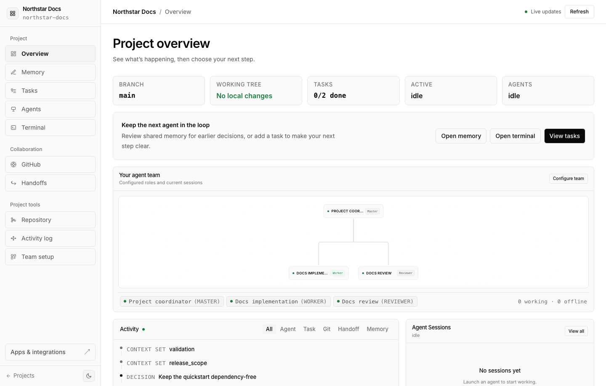
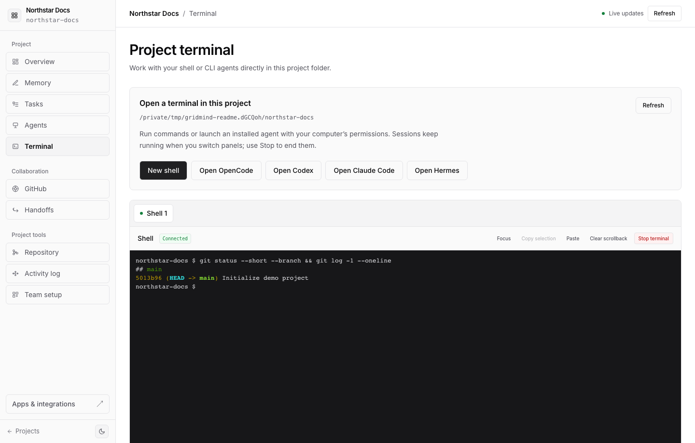
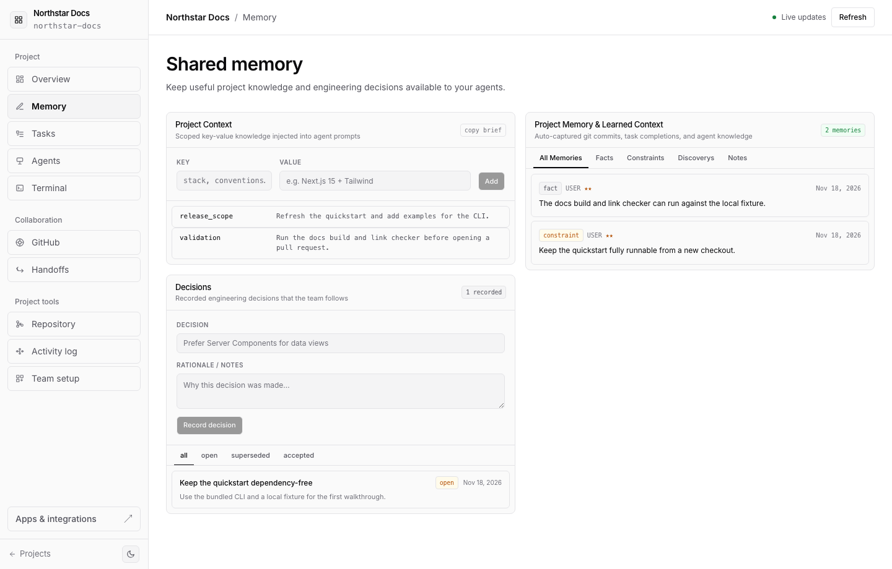

# Gridmind

**Shared project memory and a local dashboard for AI coding agents.**

Save project decisions and findings so coding agents can pick up work across sessions. Open the local dashboard to track tasks, inspect Git changes, and hand work off.

[Install](#install) · [Share project memory](#share-project-memory) · [Use the dashboard](#use-the-dashboard) · [Integration guide](docs/gui-mcp-integration.md) · [Release checklist](#release-checklist)

**v0.1.0 · Local development preview · Install from source**



## Install

You need **Git**, **Node.js 22 or newer**, and **npm**. The repository pins Node.js 26 in [`.nvmrc`](.nvmrc). An agent CLI or app is only required for the workflows that use it.

```bash
git clone https://github.com/bip-krishna/Gridmind.git
cd Gridmind
npm ci
```

| If you want to… | Run from the Gridmind checkout |
| --- | --- |
| Share saved context across coding apps without a dashboard | `npm install --global .`, then follow [Share project memory](#share-project-memory). |
| Manage a Git repository from your browser | `npm run build:mcp` and `npm run dev`, then follow [Use the dashboard](#use-the-dashboard). |

Gridmind is currently a private npm package. The global install uses your local checkout, so keep that checkout in place. To skip the global install, use `node /absolute/path/to/Gridmind/bin/gridmind.mjs` in place of `gridmind` in the commands below.

The dashboard package currently declares an Apple Silicon Tailwind dependency directly. Linux, Windows, and Intel Mac installs still need end-to-end validation. SQLite and the browser terminal also use native Node modules.

## Share project memory

Initialize the **project you work on** once. Run the preview first if you want to review the proposed file changes.

```bash
cd /path/to/your-project
gridmind init --dry-run
gridmind init
gridmind doctor
```

Setup writes project MCP settings and adds memory guidance for supported clients. It backs up changed files under `.gridmind/backups/` and reports settings that need manual attention. Generated settings contain machine-specific paths. Run setup on each machine.

| Client | Setup |
| --- | --- |
| Codex CLI, desktop, and IDE | `gridmind init` prepares `.codex/config.toml`. Open the project and approve its trust prompt. |
| Claude Code and the current VS Code Copilot harness | `gridmind init` prepares `.mcp.json`. Approve the connection in the client. |
| Cursor | `gridmind init` prepares `.cursor/mcp.json`. Enable the project server. |
| OpenCode | `gridmind init` updates the project's OpenCode config. |
| Claude Desktop | `gridmind gui claude-desktop` updates app settings. Add `--dry-run` to preview. |
| ChatGPT desktop local sessions, ChatGPT web, and other HTTP clients | Follow the app-specific steps in the [GUI and MCP setup guide](docs/gui-mcp-integration.md). |

### Verify the first handoff between clients

1. Reopen your coding client in the initialized project. Ask it to call `gridmind_get_context` and confirm the project it returns.
2. Ask the client to save a shared note via `gridmind_record_memory`, for example, “Run the docs build and link checker before opening a pull request.” Use the `project_shared` scope.
3. Open a second client in the same project and ask it to retrieve the note with `gridmind_search_memory`. Use `gridmind connections` to inspect the clients that have registered.

Clients read and write saved Gridmind records. Shared notes appear on the next read, and private notes are scoped to their MCP connection. The store lives at `.gridmind/gridmind.db` in the project. Linked Git worktrees share the main checkout's store after you initialize the client settings in each worktree.

## Use the dashboard

Start the local server from the Gridmind checkout.

```bash
npm run build:mcp
npm run dev
```

Open [127.0.0.1:3000](http://127.0.0.1:3000), choose **Add project**, and enter the absolute path to a local Git repository. Then open the project and choose the workflow you need.

| To… | Open… |
| --- | --- |
| Keep important instructions and decisions available | **Memory** for project context and shared records. |
| Track a piece of work | **Tasks → New task**. Add a description, pick a priority, and assign an agent when ready. |
| Delegate work and inspect output | **Team setup** to configure a coordinator and workers, then **Agents** to launch and watch runs. The orchestration adapters are OpenCode, Codex, and Hermes. Worker runs use task-specific Git worktrees and branches. |
| Work interactively in the repository | **Terminal → New shell**, or launch an installed OpenCode, Codex, Claude Code, or Hermes CLI. Use **Stop terminal** to end a session. |
| Continue work from another task or agent | **Handoffs** to inspect the summary, commit, blockers, and next steps. Use **Repository** to review branches, commits, and diffs. |
| Import issues or open a pull request | **Apps & integrations → GitHub** to connect an account, then the project's **GitHub** tab to link a repository, import an issue, or review the PR head and base branches. |



GitHub is optional. For issue imports and PRs, connect a fine-grained token with access to the selected repository, **Issues** read access, and **Pull requests** write access if you plan to open PRs. For browser sign-in, use a GitHub OAuth app with device flow enabled and set its public `GITHUB_CLIENT_ID` in `.env.local`. Use [`.env.example`](.env.example) as the template.

> **Local access.** Keep the dashboard bound to loopback. The browser terminal and agent processes run with the server user's OS permissions. Git worktrees separate checkouts and branches. Use the documented private MCP tunnel route for eligible ChatGPT web connections.

**Working with both modes.** The dashboard defaults to its own `.gridmind` directory in the Gridmind checkout. To view an existing folder's standalone memory in the dashboard, point it at that folder's data directory.

```bash
GRIDMIND_DATA_DIR="/absolute/path/to/your-project/.gridmind" npm run dev
```

Existing dashboard records stay in their original database. To run a production build locally, use `npm run build` followed by `npm start`.

<details>
<summary>See the shared memory screen</summary>



</details>

## Release checklist

The current preview has a working local app. The first stable release should prove that a new user can install it, retain their data through an upgrade, and complete the advertised workflows. Hosted operation and semantic search can follow as separate releases.

| Priority | Work remaining | Done when |
| --- | --- | --- |
| Before stable release | **Package and publish.** Replace the platform-specific dashboard dependency, confirm the npm package name, add the repository license and package metadata, and set up a tagged release workflow. | A clean machine installs from the published artifact and completes `gridmind init` without a checkout. |
| Before stable release | **Triage dependency advisories.** Review the clean-install audit, update affected dependencies, and rerun the install, build, and integration checks. | Critical and high findings affecting shipped code are resolved or have a documented mitigation and owner. |
| Before stable release | **Verify supported platforms in CI.** Cover native SQLite, the dashboard build, and PTY startup, resizing, and cleanup on each advertised OS and architecture. | A documented CI matrix passes install, build, smoke, and integration checks on every supported target. |
| Before stable release | **Verify live client and GitHub workflows.** Exercise local coding apps, Claude Desktop, an eligible ChatGPT tunnel, and a disposable GitHub repository. | Two real clients exchange a shared note, GitHub sign-in and issue import work, and an operator can open a PR from a task branch. |
| Before stable release | **Prove upgrade and recovery behavior.** Add repeatable backup and restore instructions, test legacy databases, and verify failure recovery during worktree provisioning and agent or terminal shutdown. | Upgrade and restore preserve tasks and memory, and interrupted runs leave a clear, recoverable state. |
| After local release | **Evaluate semantic retrieval.** Add a versioned embedding pipeline and benchmark hybrid retrieval against the current keyword search if results justify it. | Relevance improves on representative queries, privacy scopes hold, and keyword search remains usable while indexes rebuild. |
| After local release | **Design authenticated remote collaboration.** Define multi-user authorization, cross-machine storage, and execution isolation before offering hosted operation. | Authorized teammates can share project records across machines and cannot read other projects or launch processes outside their authorized environment. |

## Development checks

```bash
npm test                  # Unit, CLI, GitHub, and MCP fixtures
npm run typecheck         # TypeScript
npm run lint              # ESLint
npm run build             # Production app and both MCP bundles
npm run test:integration  # Disposable local server, Git repos, and real PTY fixtures
```

The automated suites use fixture agent processes and mocked GitHub responses. Live app authorization, paid model runs, and live GitHub PR creation are release acceptance checks.

[GUI and MCP setup guide](docs/gui-mcp-integration.md) · [Original architecture and dashboard MCP reference](Detailed_Report.md)
