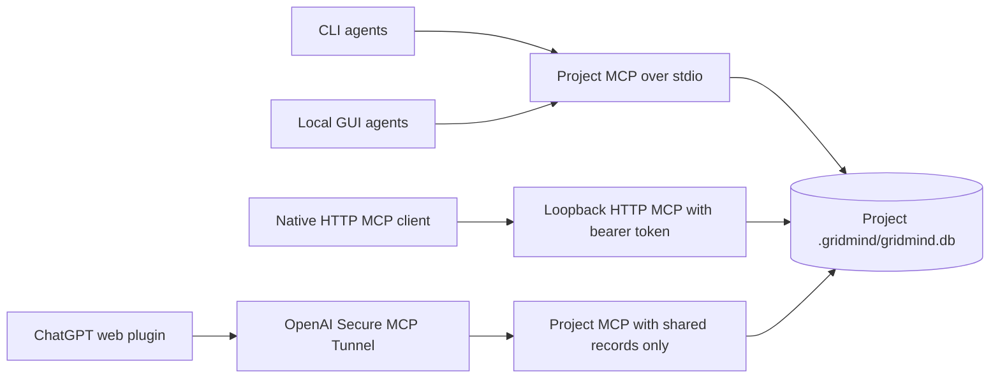

# GUI agent connections and MCP

Research checked on 17 November 2026. Gridmind can share one project's saved memory with local GUI agents and CLI agents through the same MCP implementation. Local desktop sessions are the shortest path. ChatGPT web needs a connection that can reach the machine; Gridmind now supports OpenAI's private tunnel workflow without making its dashboard public.

## Which connection to use

| Client and surface | Supported route | Gridmind setup | Remaining app step |
| --- | --- | --- | --- |
| ChatGPT desktop with local computer access, Codex desktop, CLI and IDE on the same host | Local stdio or authenticated Streamable HTTP | `gridmind init` for shared project configuration; optional `gridmind gui chatgpt-desktop` for a local plugin | Trust the project and restart the MCP connection. For a generated plugin, register its marketplace and install from the desktop Plugins Directory. |
| ChatGPT web or a hosted chat | Secure MCP Tunnel, or a separately hosted MCP service | `gridmind tunnel --tunnel-id …` | Provision/link an eligible tunnel and runtime key, create the custom MCP plugin with Connection: Tunnel, then verify a call. |
| Claude Desktop local tools | App-level stdio configuration | `gridmind gui claude-desktop` | Restart Claude Desktop and review the enabled local tools. |
| Cursor | Project `.cursor/mcp.json` | `gridmind init` | Open that project, review its MCP prompt and enable the server. |
| VS Code with the current Copilot harness | Workspace `.mcp.json` | `gridmind init` | Review the workspace MCP connection. Older Local harness configurations use a different format. |
| Another native MCP client supporting bearer headers | Local Streamable HTTP | `gridmind serve` | Add the printed `/mcp` address and the credential from its local token file. |

OpenAI's current guide says desktop local clients share Codex configuration, including trusted project `.codex/config.toml`. ChatGPT web does not read those files. The desktop settings also support adding a stdio command manually. These capabilities depend on the selected execution surface and workspace policy. [OpenAI MCP guide](https://learn.chatgpt.com/docs/extend/mcp?surface=app).

Cursor documents project and user MCP configuration, including stdio and HTTP. VS Code's current Copilot harness accepts portable `mcpServers` entries at `.mcp.json`; its older `.vscode/mcp.json` format belongs to the Local compatibility harness. Gridmind emits an explicit `type: "stdio"` for the shared JSON configurations. [Cursor MCP](https://cursor.com/docs/mcp), [VS Code MCP configuration](https://code.visualstudio.com/docs/agents/reference/mcp-configuration).

Claude's local desktop configuration remains supported. Its preferred packaged GUI installation is a desktop extension (`.mcpb`), which can include a folder picker. Gridmind currently uses the installed Node launcher instead: bundling its native SQLite dependency into an extension would require packaging and testing each platform's binary. Claude's cloud connectors are a separate feature and require a reachable HTTPS endpoint, even when used from its desktop UI. [Local MCP tutorial](https://modelcontextprotocol.io/docs/2026-07-28/develop/connect-local-servers), [Claude desktop extensions](https://support.claude.com/en/articles/10949351-getting-started-with-local-mcp-servers-on-claude-desktop), [MCPB manifest](https://github.com/modelcontextprotocol/mcpb/blob/main/MANIFEST.md), [Claude remote connectors](https://support.claude.com/en/articles/11175166-get-started-with-custom-connectors-using-remote-mcp).

## One memory store across transports



Every setup pins an explicit project directory. A GUI app's launch directory is not used to choose memory. Linked Git worktrees resolve to the same main project store; different projects remain separate. Shared records become visible on the next read. This does not copy chats, inspect other apps' conversations, or force a model to call a tool.

The dashboard uses its own configured data directory. To display the same folder store, launch it with `GRIDMIND_DATA_DIR=/absolute/project/.gridmind`; existing dashboard records are not silently migrated into a new folder store.

## Local desktop setup

Run these from the Gridmind source checkout. An installed `gridmind` command can replace `node bin/gridmind.mjs`. Node 22 or later and installed project dependencies are required.

```bash
npm run build:memory
node bin/gridmind.mjs init --project /absolute/project
node bin/gridmind.mjs gui --project /absolute/project
```

`gui` only reports standard app locations and prepared configuration. It does not install anything or monitor other processes. `doctor` checks the existing project client configurations.

For Claude Desktop:

```bash
node bin/gridmind.mjs gui claude-desktop --project /absolute/project --dry-run
node bin/gridmind.mjs gui claude-desktop --project /absolute/project
```

The second command updates Claude's user-level configuration, preserving other entries and backing up the previous file under this project's `.gridmind/backups/`. Each project gets a unique server name and explicit folder argument. Malformed, conflicting and symlinked configurations are left intact. Restart the app afterward. On macOS the file is under `~/Library/Application Support/Claude/`; Windows uses `%APPDATA%/Claude/`. The Linux path is prepared for compatible clients; official Claude Desktop availability must be checked separately.

For an OpenAI local plugin:

```bash
node bin/gridmind.mjs gui chatgpt-desktop --project /absolute/project
```

This prepares portable `plugin.json`, `mcp.json` and a project-specific local marketplace under `.gridmind/gui/openai/`. Run the returned `codex plugin marketplace add` command, restart the desktop app and install Gridmind from that marketplace. The plugin launches the installed Gridmind executable with this project's absolute path; it is not a self-contained binary or a public-directory submission. Direct project configuration from `init` is sufficient when a plugin card is unnecessary; avoid enabling duplicate connections for the same project.

The local marketplace and portable package formats follow OpenAI's current plugin documentation. A public desktop-only submission has separate eligibility and approval requirements. No publication is needed for the local authoring workflow. [Plugin packaging](https://developers.openai.com/plugins/build/plugins), [Desktop-only submissions](https://developers.openai.com/plugins/deploy/desktop-only).

## ChatGPT web through a private tunnel

OpenAI's Secure MCP Tunnel can forward requests to a local stdio command over an outbound connection. It avoids opening the Gridmind dashboard or a new inbound public port. It still sends requested memory through OpenAI and requires the appropriate account/workspace access. [Secure MCP Tunnel](https://developers.openai.com/api/docs/guides/secure-mcp-tunnels).

1. Install the supported `tunnel-client` from OpenAI Platform tunnel settings or its official release page. Check `tunnel-client help quickstart`.
2. Create or select a tunnel linked to the intended ChatGPT workspace. The runtime key needs Tunnels Read and Use; provisioning needs separate management permission.
3. Set `CONTROL_PLANE_API_KEY` securely in the runtime environment. Do not paste its value into project configuration, command arguments or a chat.
4. Inspect the plan, then start it in the foreground:

```bash
node bin/gridmind.mjs tunnel --project /absolute/project --tunnel-id tunnel_YOUR_ID --dry-run
node bin/gridmind.mjs tunnel --project /absolute/project --tunnel-id tunnel_YOUR_ID
```

5. In ChatGPT Plugins, add a custom MCP server, choose Tunnel, select the same tunnel and complete the app's required confirmation. Keep the runtime running while discovering tools and making calls.
6. Ask for `gridmind_get_context`, then verify the returned project and read a known fixture fact. A running process alone does not prove the app is connected.

The wrapper uses the documented `run` options with an environment reference for the runtime key. It does not create a tunnel, download a binary, install a plugin, or claim readiness. [Official tunnel onboarding](https://github.com/openai/tunnel-client/blob/master/docs/onboarding.md).

Tunnel access defaults to read-only. Add `--write` to allow shared memory, context and decision writes. Private scopes are always unavailable on this route: the official tunnel's stdio channel shares one child connection, so it cannot represent private notes for separate chats. Run one active runtime per tunnel ID. [Tunnel configuration and stdio limits](https://github.com/openai/tunnel-client/blob/master/docs/configuration.md#stdio-deployment-limits).

## Authenticated HTTP MCP

```bash
node bin/gridmind.mjs serve --project /absolute/project
# Enable writes only when wanted:
node bin/gridmind.mjs serve --project /absolute/project --write
```

The server prints its URL, token-file path, project and access mode. It listens only on `127.0.0.1`, using port 47831 by default (`--port` overrides it). The random bearer credential stays in `.gridmind/http-token`, with owner-only permissions. Enter its value into the client's secret/header field as `Authorization: Bearer …`. It never belongs in the URL or committed client configuration. Stop the server, remove the token file, then restart to rotate it.

Each initialized HTTP connection has its own private-memory session; all clients must authenticate every request. The server bounds request bodies and active sessions, expires idle sessions, validates Host/Origin and closes sessions during shutdown. Default read-only mode advertises four read tools; `--write` exposes all seven memory tools. Tool annotations describe read/write behavior but enforcement happens in server registration and input validation.

This is an MCP endpoint, not an OAuth authorization server. A cloud client cannot connect directly to its loopback address. Public remote access would need a separately configured HTTPS boundary and suitable authentication; direct ChatGPT OAuth is not implemented by this endpoint. Gridmind does not automatically start public tunnels or forward its dashboard APIs. HTTP authentication follows the header credential boundary described in the [MCP authorization specification](https://modelcontextprotocol.io/specification/2025-11-25/basic/authorization).

## Verify memory from a GUI app

Ask the app: "Use Gridmind to identify this project and read its saved context." For a writable local connection, save a harmless shared note, then retrieve it from a second client opened on the same folder. Finish by checking:

```bash
node bin/gridmind.mjs connections --project /absolute/project
```

Client names are self-reported MCP identities. The list records connection lifecycle, not OS process detection or proof that every new task used memory. Private notes belong to an individual MCP connection, not a permanent provider identity. An app restart creates a new connection.

## Implementation and test boundaries

The installed TypeScript SDK is 1.30.0, with protocol support through `2025-11-25`. Both stdio and Streamable HTTP use the same server factory and retrieval/store code. The newer `2026-07-28` transport changes are not claimed as implemented; client compatibility must be checked through negotiation and real app calls.

Automated coverage includes real SDK stdio/HTTP interoperability, persistence after restart, project and private-note isolation, rejected credentials/hosts/origins, read-only enforcement, session limits, shared-only tunnel restrictions, configuration backups/conflicts/symlinks, and literal argument handling. GUI setup uses fixture homes; the tunnel wrapper uses a fixture executable. No real ChatGPT or Claude account was authorized, no live tunnel was provisioned, and no public plugin was submitted. The Apps & integrations page supplies project-specific setup commands and a portable stdio configuration download.

Optional next work is a platform-tested Claude desktop extension, an OAuth-backed hosted service, and client-specific live acceptance tests. These are separate from the working local transports and setup helpers.
